# Ad Skill Jam



[](#pick-a-platform)
[](ad-skill-jam/README.md)
[](ad-skill-jam/_shared/evals/README.md)
[](ad-skill-jam/mcp/README.md)

**Give your AI agent a paid media playbook for 12 ad platforms.** Ad Skill Jam includes skills for Google Ads, Meta Ads, YouTube Ads, LinkedIn Ads, Reddit Ads, TikTok Ads, X Ads, Snapchat Ads, Pinterest Ads, Microsoft Advertising, Apple Ads, and Amazon Ads. Use them to audit accounts, plan campaigns, and trace drops in conversions back to the evidence.

- **See where the guidance comes from.** We combined workflows from ad tools and playbooks, checked platform claims against official docs, and dated the source notes. [Source provenance](ad-skill-jam/_shared/provenance/SOURCES.md)
- **See how a workflow should behave.** Eval cases spell out what the agent should do when evidence is missing or someone asks it to spend without approval. [Eval guide](ad-skill-jam/_shared/evals/README.md)
- **Start with an export.** Use a redacted report or connect the local MCP for read-only campaign inventory. The playbooks put you in charge of approving account changes. [MCP setup](ad-skill-jam/mcp/README.md) · [Approval workflow](ad-skill-jam/ads/ad-approval-gates/SKILL.md)

## Choose a setup

| What you want | Setup |
| --- | --- |
| Use ad playbooks in your agent | [Install skills](#install-skills) with the Skills CLI or the platform-pack scripts. |
| Read campaign inventory from your IDE | [Set up the local MCP](ad-skill-jam/mcp/README.md#install-in-an-ide) with a client install link or manual configuration. |
| Install the MCP in a compatible desktop client | [Download the desktop bundle](https://github.com/VRIL-LABS/ad-skill-jam/releases/latest/download/ad-skill-jam.mcpb) or [build it locally](ad-skill-jam/mcp/README.md#install-a-desktop-bundle). |

### Install skills

Browse the collection before installing, or pick the skills you need.

```sh
# List the available skills without installing them
npx skills add https://github.com/VRIL-LABS/ad-skill-jam/tree/main/ad-skill-jam --list

# Install the full collection
npx skills add https://github.com/VRIL-LABS/ad-skill-jam/tree/main/ad-skill-jam --skill "*"

# Install a search-term workflow and its shared approval skill for Codex
npx skills add https://github.com/VRIL-LABS/ad-skill-jam/tree/main/ad-skill-jam --skill google-ads-search-terms --skill ad-approval-gates -a codex
```

Run these commands in the project where you want the skills. For linked API ledgers, cross-skill references, and the local MCP, keep a checkout of the full repository and make it available to your agent. [Skills CLI](https://github.com/vercel-labs/skills)

<details>

<summary><strong>Install one or more platform packs</strong></summary>

The scripts fetch your chosen packs from GitHub and copy the skills into the current project. Run them from your destination project. Use the script from your Ad Skill Jam checkout or download [the Bash script](ad-skill-jam/scripts/install-packs.sh) or [the PowerShell script](ad-skill-jam/scripts/install-packs.ps1). Node.js 24+, npm, and Git must be on your path.

**Linux and macOS**

```sh
bash /path/to/ad-skill-jam/ad-skill-jam/scripts/install-packs.sh --agent codex google meta shared
```

**Windows**

```powershell
& 'C:/path/to/ad-skill-jam/ad-skill-jam/scripts/install-packs.ps1' -Packs google,meta,shared -Agent codex
```

Select `amazon`, `apple`, `google`, `linkedin`, `meta`, `microsoft`, `pinterest`, `reddit`, `snapchat`, `tiktok`, `x`, or `youtube`. Use `shared` for cross-platform skills or `all` by itself for the full collection. Omit the agent option to let the Skills CLI choose or prompt. Use `--list` or `-List` to preview a selection.

</details>

## Pick a platform

Select a logo or pack name for its skill index. The links underneath open the providers’ advertising sites.

<table>
  <tr>
    <td align="center" width="25%"><a href="ad-skill-jam/meta-ads/README.md"> <br>Meta Ads</a><br><sub><a href="https://secure.facebook.com/business/ads">Facebook Ads ↗</a> · <a href="https://business.instagram.com/advertising">Instagram Ads ↗</a></sub></td>
    <td align="center" width="25%"><a href="ad-skill-jam/google-ads/README.md"><br>Google Ads</a><br><sub><a href="https://ads.google.com/home/">Google Ads site ↗</a></sub></td>
    <td align="center" width="25%"><a href="ad-skill-jam/youtube-ads/README.md"><br>YouTube Ads</a><br><sub><a href="https://business.google.com/us/ad-solutions/youtube-ads/">YouTube Ads site ↗</a></sub></td>
    <td align="center" width="25%"><a href="ad-skill-jam/linkedin-ads/README.md"><br>LinkedIn Ads</a><br><sub><a href="https://business.linkedin.com/advertise/ads">LinkedIn Ads site ↗</a></sub></td>
  </tr>
  <tr>
    <td align="center" width="25%"><a href="ad-skill-jam/reddit-ads/README.md"><br>Reddit Ads</a><br><sub><a href="https://www.business.reddit.com/advertise">Reddit Ads site ↗</a></sub></td>
    <td align="center" width="25%"><a href="ad-skill-jam/tiktok-ads/README.md"><br>TikTok Ads</a><br><sub><a href="https://ads.tiktok.com/business/en/home">TikTok Ads site ↗</a></sub></td>
    <td align="center" width="25%"><a href="ad-skill-jam/x-ads/README.md"><br>X Ads</a><br><sub><a href="https://business.x.com/en/advertising">X Ads site ↗</a></sub></td>
    <td align="center" width="25%"><a href="ad-skill-jam/snapchat-ads/README.md"><br>Snapchat Ads</a><br><sub><a href="https://forbusiness.snapchat.com/advertising">Snapchat Ads site ↗</a></sub></td>
  </tr>
  <tr>
    <td align="center" width="25%"><a href="ad-skill-jam/pinterest-ads/README.md"><br>Pinterest Ads</a><br><sub><a href="https://business.pinterest.com/advertise/">Pinterest Ads site ↗</a></sub></td>
    <td align="center" width="25%"><a href="ad-skill-jam/microsoft-ads/README.md"><br>Microsoft Advertising</a><br><sub><a href="https://about.ads.microsoft.com/en">Microsoft Ads site ↗</a></sub></td>
    <td align="center" width="25%"><a href="ad-skill-jam/apple-ads/README.md"><br>Apple Ads</a><br><sub><a href="https://ads.apple.com/">Apple Ads site ↗</a></sub></td>
    <td align="center" width="25%"><a href="ad-skill-jam/amazon-ads/README.md"><br>Amazon Ads</a><br><sub><a href="https://advertising.amazon.com/">Amazon Ads site ↗</a></sub></td>
  </tr>
</table>

## Get started

1. [Pick your platform](#pick-a-platform) and choose a skill by task.
2. Give your agent the `SKILL.md` and keep the pack tree available for its linked references.
3. Attach a redacted export with the date range, timezone, currency, and attribution settings. Tell the agent what decision you’re trying to make.

### Try a search-term review

Give your agent the [Google Ads search terms skill](ad-skill-jam/google-ads/google-ads-search-terms/SKILL.md) and a redacted search terms export. Supply the products or services you advertise, your target locations, and any current negative keywords you can share.

```text
Review this Google Ads search terms export. Group queries by intent and flag
potential negative keywords. For each candidate, show the evidence, suggested
match type and scope, and possible conflicts. List any missing inputs that
affect your confidence. Return a proposal for review.
```

Use the [approval gate](ad-skill-jam/ads/ad-approval-gates/SKILL.md) before changing an ad account.

<details>

<summary><strong>Local MCP quick start</strong></summary>

Use the local MCP for read-only campaign inventory. You can start it, check setup, and browse skills before connecting an advertising account.

From the repository root, with Node.js 24 or later:

```sh
cd ad-skill-jam/mcp
npm ci --ignore-scripts
npm run check
npm test
```

Register `node` with the absolute path to `ad-skill-jam/mcp/gateway/stdio.ts` in your MCP client. Call `adjam_health_check` to confirm the server is ready. The [MCP guide](ad-skill-jam/mcp/README.md) has Codex and JSON configuration examples, account setup, and error codes.

[](https://vscode.dev/redirect?url=vscode%3Amcp%2Finstall%3F%257B%2522name%2522%253A%2522ad-skill-jam%2522%252C%2522type%2522%253A%2522stdio%2522%252C%2522command%2522%253A%2522node%2522%252C%2522args%2522%253A%255B%2522%2524%257BworkspaceFolder%257D%252Fad-skill-jam%252Fmcp%252Fgateway%252Fstdio.ts%2522%255D%257D) · [Install links by IDE](ad-skill-jam/mcp/README.md#install-in-an-ide) · [Desktop bundle](ad-skill-jam/mcp/README.md#install-a-desktop-bundle)

</details>

<details>

<summary><strong>Project reference and roadmap</strong></summary>

- [Skill collection](ad-skill-jam/README.md) and [source provenance](ad-skill-jam/_shared/provenance/SOURCES.md)
- [Pack checks and behavioral evals](ad-skill-jam/_shared/evals/README.md)
- [Reference repository map](FUSION_MAP.md)
- [MCP architecture and roadmap](ADS_MCP_PLAN.md) and [protocol decisions](MCP_MAP.md)

</details>

## Contribute

Read the [contribution guide](CONTRIBUTING.md) and [code of conduct](CODE_OF_CONDUCT.md). Agents should start with [AGENTS.md](AGENTS.md) for pack routing and checks.

[Contributors](CONTRIBUTORS.md) · [Changelog](CHANGELOG.md) · [Accessibility](ACCESSIBILITY.md) · [Support](SUPPORT.md) · [Security policy](SECURITY.md)

<details>

<summary>Artwork credits</summary>

Provider icons come from the [Social Media Icons & Logos Figma Community file](https://www.figma.com/design/G3UOnXFeTkpUjHZIKcffiy/Social-Media-Icons---Logos--Community-?node-id=0-1), [SVG Logos for Microsoft](https://github.com/gilbarbara/logos/blob/main/logos/microsoft-icon.svg), and [Wikimedia Commons for Amazon](https://commons.wikimedia.org/wiki/File:Amazon_logo.svg). The marks identify the corresponding providers.

</details>

## Fund Ad Skill Jam

Help keep the playbooks and platform references up to date.

[](https://github.com/sponsors/VRIL-LABS)
[](https://opencollective.com/vrillabs)
[](https://ko-fi.com/vrillabs)
[](https://buymeacoffee.com/vrillabs)
[](https://thanks.dev/u/gh/vril-labs)

## More from VRIL LABS

Ad Skill Jam grew out of the original [@VRIL-LABS/skill-jam](https://github.com/VRIL-LABS/skill-jam), a broader collection of agent skills.
