# Ad Skill Jam skills

Start with a question about your ads. Give your agent the playbook for that platform and task, whether you’re auditing spend, planning a campaign, reviewing creative, or untangling conversion data. A redacted export can get you started without connecting an account.

## Use the skills

Choose a platform, then open the skill for your task. Give your agent the `SKILL.md` and keep the pack tree intact so it can read linked references. For exports, redact identifiers and include the date range, timezone, currency, and attribution settings.

<table>
  <tr>
    <td align="center" width="25%"><a href="meta-ads/README.md">  Meta Ads</a></td>
    <td align="center" width="25%"><a href="google-ads/README.md"> Google Ads</a></td>
    <td align="center" width="25%"><a href="youtube-ads/README.md"> YouTube Ads</a></td>
    <td align="center" width="25%"><a href="linkedin-ads/README.md"> LinkedIn Ads</a></td>
  </tr>
  <tr>
    <td align="center" width="25%"><a href="reddit-ads/README.md"> Reddit Ads</a></td>
    <td align="center" width="25%"><a href="tiktok-ads/README.md"> TikTok Ads</a></td>
    <td align="center" width="25%"><a href="x-ads/README.md"> X Ads</a></td>
    <td align="center" width="25%"><a href="snapchat-ads/README.md"> Snapchat Ads</a></td>
  </tr>
  <tr>
    <td align="center" width="25%"><a href="pinterest-ads/README.md"> Pinterest Ads</a></td>
    <td align="center" width="25%"><a href="microsoft-ads/README.md"> Microsoft Advertising</a></td>
    <td align="center" width="25%"><a href="apple-ads/README.md"> Apple Ads</a></td>
    <td align="center" width="25%"><a href="amazon-ads/README.md"> Amazon Ads</a></td>
  </tr>
</table>

## Install skills

From the project where you want the skills, run the [Bash installer](scripts/install-packs.sh) on Linux or macOS, or the [PowerShell installer](scripts/install-packs.ps1) on Windows. Use Node.js 24+, npm, and Git. Specify pack names such as `google` and `meta`, add `shared` for cross-platform skills, or choose `all` by itself. Each platform README also has a direct Skills CLI command.

<strong>Shared advertising skills</strong>

| Task | Skill |
| --- | --- |
| Score an audit and report evidence gaps | [Ad audit](ads/ad-audit/SKILL.md) |
| Review performance and reconcile reports | [Ad reporting](ads/ad-reporting/SKILL.md) |
| Edit advertising copy | [Ad copy review](ads/ad-antislop/SKILL.md) |
| Review and approve an account change | [Approval gate](ads/ad-approval-gates/SKILL.md) |

## Run the MCP

 · [Install links by IDE](mcp/README.md#install-in-an-ide) · [Desktop bundle](mcp/README.md#install-a-desktop-bundle)

The local server supports health checks, account setup, and skill browsing without credentials. With a configured account, use it to fetch read-only campaign inventory. Clients with Skills over MCP can look up a skill by its frontmatter `name` and open its supporting files from the catalog. [MCP setup and troubleshooting](mcp/README.md)

<strong>Source notes and validation</strong>

Each platform index links to its API ledger. See the [source manifest](_shared/provenance/SOURCES.md) for mined repositories and the [eval guide](_shared/evals/README.md) for pack validation and behavior fixtures.

